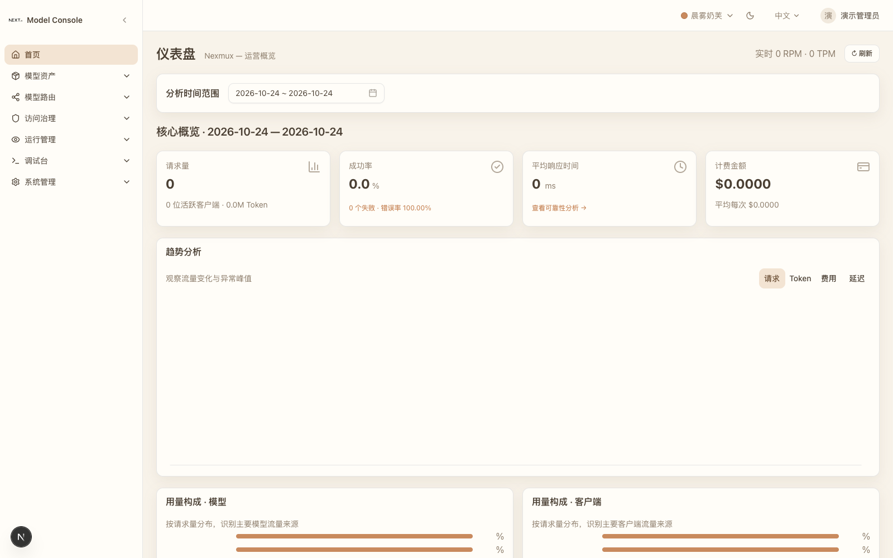
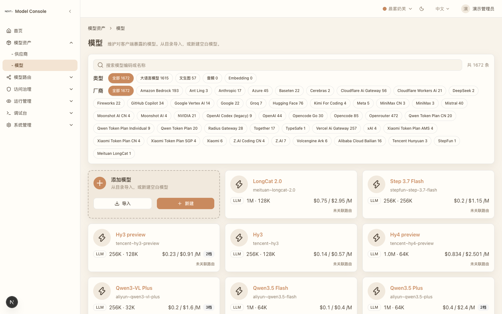
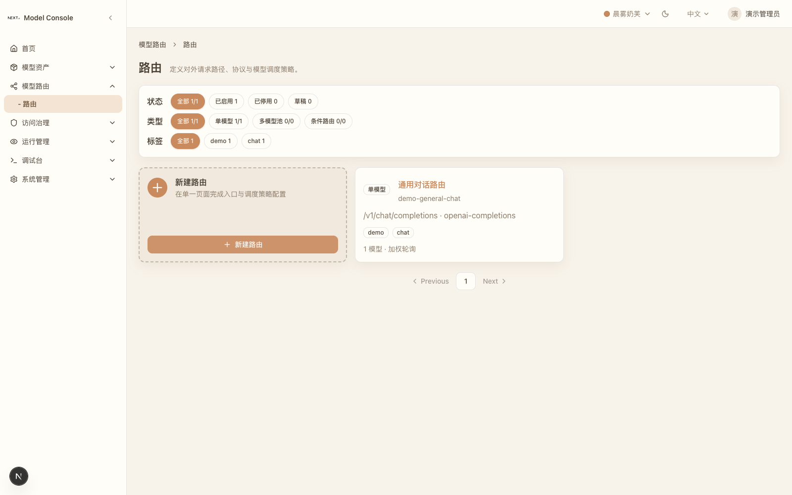

# Nexmux

[](https://github.com/innospots/nexmux/actions/workflows/ci.yml)
[](https://openjdk.org/)
[](./LICENSE)

**Nexmux 是一个企业级模型网关与 Model Console。** 它把上游模型供应商、逻辑模型、路由和客户端凭证统一起来，让业务项目只依赖一套 OpenAI 兼容 API，而不必直接管理多个供应商的连接与密钥。

当前版本：`0.1.0-SNAPSHOT`。

## 核心能力

- **供应商与模型资产**：Provider、逻辑 Model、主/扩展 Provider Model Binding、默认参数和分档定价。
- **模型路由**：Alias、Ingress、候选模型、权重、优先级、轮询、HASH/RANDOM、粘性会话和健康过滤。
- **访问治理**：Client/AppKey、Route 授权、有效期、配额、限流和客户端模板。
- **真实 Model Runtime**：独立 JVM 进程，通过周期快照消费已发布配置，Console 离线不影响已加载流量。
- **可观测性**：请求日志、Route Trace、Pricing Snapshot、标准参考金额、内部参考消费金额和供应商成本估算。
- **运行版本**：Route 配置修订、历史版本与回滚；Client 策略修订与审计快照。
- **测试基线**：340 个后端测试 + 100 个 Console → Runtime 编号检查点。

## 当前 API

| API | 能力 |
|---|---|
| `GET /v1/models` | 列出当前 AppKey 已授权、已发布的 Alias |
| `POST /v1/chat/completions` | OpenAI Chat Completions，支持非流式和 SSE |
| `POST /v1/responses` | OpenAI Responses，非流式 |
| `POST /v1/messages` | Anthropic Messages，非流式 |
| `POST /v1/embeddings` | OpenAI Embeddings |

所有 Runtime 入口都经过同一套 AppKey 鉴权、路由授权、配额、限流、选路和计量管线。

> Responses、Messages、Embeddings 的 Streaming 尚未开放。当前上游 Adapter 为 OpenAI Compatible；其他上游协议会明确拒绝，不会被错误地按 OpenAI 报文转发。

## 控制台预览

| 运营概览 | 模型资产 | 模型路由 |
|---|---|---|
|  |  |  |
| 核心指标、趋势与用量构成 | 模型目录、类型与供应商筛选 | Alias、协议、候选模型与调度策略 |

## 架构

```text
业务项目 / OpenAI SDK
          │
          │ AppKey + Route Alias
          ▼
┌───────────────────────┐
│    Model Runtime      │
│  /v1/**               │
│  鉴权 → 授权 → 配额   │
│  → 限流 → 选路 → 计量 │
└──────────┬────────────┘
           │ 内存快照
           ▼
   已发布 Route / Client / Model / Provider
           ▲
           │ 周期刷新
┌──────────┴────────────┐        ┌────────────────────┐
│     Model Console     │        │    nexmux-ui       │
│     /api/d/**         │◄──────►│  Next.js + PageDsl │
│  配置、发布、审计      │        │  管理控制台         │
└──────────┬────────────┘        └────────────────────┘
           │
           ▼
   H2 文件库（本地）/ 数据库账号分责（生产建议）
```

Console 与 Runtime 使用同一个发行 artifact，但在**独立 JVM 进程**中运行。Runtime 不调用 Console 的在线接口，配置变更经快照刷新生效。

## 仓库结构

```text
nexmux/
├── pom.xml                         # 根 reactor：parent 与 dependencyManagement
├── nexmux-bom/                     # 产品 BOM
├── nexmux-kernel/                  # 纯 Java 产品内核
│   └── src/main/java/com/innospots/nexmux/
│       ├── core/                   # Provider/Model/Route/Client/Ops/Settings/Shared
│       ├── console/                # JAX-RS 管理端点与页面投影
│       └── inbound/                # Runtime Ingress、Pipeline、Protocol、快照与健康
├── nexmux-spring/                  # Spring Boot 可运行组装与发行包
│   ├── src/main/java/.../config/   # 集中 Bean 装配，业务代码不依赖 Spring
│   ├── src/main/resources/         # YAML、DDL、catalog 与 profile 配置
│   └── bin/                        # startup/shutdown/setenv 与 assembly 描述
├── nexmux-ui/                      # Next.js + Pactor DSL 管理控制台
├── docs/                           # 设计、运行、接入、功能与端测文档
├── scripts/                        # 数据库与 Runtime E2E 工具
└── .github/workflows/ci.yml        # 后端/前端 CI
```

更详细的包边界、数据流和持久化说明见 [工程结构指南](./docs/nexmux-engineering.md)。

## 环境要求

| 工具 | 版本 |
|---|---|
| JDK | 25+ |
| Maven | 3.9+ |
| Node.js | 22+ |
| pnpm | 与 lockfile 匹配的版本 |
| 数据库 | 本地 H2（内置）；生产按组织的数据库规范评估 |

平台能力通过 `innospots-nexus-*` Maven 依赖挂接，不复制 Nexus 源码到本仓库。

## 从源码构建

### 1. 构建平台依赖

平台仓库应与本仓库放在同一父目录：

```text
workspace/
├── innospots-nexus/
└── nexmux/
```

先安装 Nexus 的 SNAPSHOT 依赖：

```bash
cd ../innospots-nexus
mvn clean install -DskipTests
```

### 2. 构建 Nexmux

```bash
cd ../nexmux
mvn validate clean test
mvn package -pl nexmux-spring -am -DskipTests
```

产物：

```text
dist/nexmux-spring.tar.gz
```

### 3. 构建管理控制台

```bash
cd nexmux-ui
pnpm install --frozen-lockfile
pnpm build
```

## 快速启动

### 本地 Console 与 Runtime

```bash
tar -xzf dist/nexmux-spring.tar.gz -C /tmp
cd /tmp/nexmux-spring

# fresh 数据库必须先启动 Console：DDL 与种子数据由 Console 执行
./bin/startup.sh "local"

# 再启动独立 Runtime 进程
./bin/startup.sh "local,runtime"
```

默认端口：

| 组件 | 默认地址 | 说明 |
|---|---|---|
| Console | `http://localhost:8082` | `/api/d/**` 管理接口 |
| Runtime | `http://localhost:8083` | `/v1/**` 模型调用入口 |
| UI | `http://localhost:9011` | 管理控制台 |

本地共用 `./out/db/nexus-platform-console`。如果跨目录启动，请为 Runtime 设置绝对 `SPRING_DATASOURCE_URL`，避免两个进程各用一套库。

### 管理控制台 UI

```bash
cd nexmux-ui
pnpm dev
```

默认 UI：`http://localhost:9011`。本地演示账号：

- `admin / pactor123`
- `guest / guest123`

> 演示账号只用于本地联调，不得用于生产。生产部署请接入外部身份系统并启用安全认证。

## 给业务项目接入 Runtime

### 准备配置

在 Console 中完成：

1. 创建并启用 Provider；
2. 创建并启用 Model，配置有效 Binding；
3. 创建并发布 Route；
4. 创建 Client，授权该 Route 并取得一次性 AppKey Secret。

**调用时使用 Nexmux AppKey，不是上游供应商密钥。`model` 字段填写 Route Alias，不是上游模型 ID。**

### 查看可用 Alias

```bash
curl http://localhost:8083/v1/models \
  -H "Authorization: Bearer <NEXMUX_APPKEY>"
```

### 非流式调用

```bash
curl http://localhost:8083/v1/chat/completions \
  -H "Authorization: Bearer <NEXMUX_APPKEY>" \
  -H "Content-Type: application/json" \
  -d '{
    "model": "<ROUTE_ALIAS>",
    "messages": [{"role": "user", "content": "你好"}]
  }'
```

### Python / OpenAI SDK

```python
from openai import OpenAI

client = OpenAI(
    base_url="http://localhost:8083/v1",
    api_key="<NEXMUX_APPKEY>",
)

response = client.chat.completions.create(
    model="<ROUTE_ALIAS>",
    messages=[{"role": "user", "content": "你好"}],
)

print(response.choices[0].message.content)
```

更多协议示例、错误码和排障方式见 [模型接入指南](./docs/nexmux-integration-guide.md)。

## 配置与运行

### 关键配置

| 配置 | 默认值 | 说明 |
|---|---:|---|
| `nexmux.runtime.snapshot-poll-interval-seconds` | 30 | Runtime 配置快照刷新周期 |
| `nexmux.runtime.health-probe-interval-seconds` | 60 | Binding 主动探活周期 |
| `nexmux.runtime.health-probe-timeout-ms` | 5000 | 探测超时 |
| `nexmux.runtime.health-unhealthy-threshold` | 3 | 连续失败判 UNAVAILABLE |
| `nexmux.runtime.health-degraded-latency-ms` | 10000 | 延迟超此值判 DEGRADED |
| `nexmux.runtime.quota-resync-interval-seconds` | 300 | 配额与运行日志校准周期 |
| `nexmux.runtime.log-retention-initial-delay-minutes` | 10 | 日志清理首次执行延迟 |
| `nexmux.runtime.log-retention-period-minutes` | 1440 | 日志清理周期，默认每日 |

`config/` 同时挂载到两个进程；Runtime 专属覆盖放在 `config/application-runtime.yaml`。

### 安全相关环境变量

| 变量 | 用途 |
|---|---|
| `CONSOLE_TOKEN_SECRET` | 生产 Console/Runtime 控制台令牌密钥，两个进程必须同值 |
| `NEXMUX_CREDENTIAL_SECRET` | Provider 上游凭证 AES-GCM 落库加密密钥，生产必配 |
| `DB_URL` / `SPRING_DATASOURCE_URL` | 数据库连接；生产建议绝对路径 |
| `NEXT_PUBLIC_API_BASE_URL` | UI 的 Console API 基址，构建期内联，修改后需重新构建 |

未配置 `NEXMUX_CREDENTIAL_SECRET` 时，本地兼容明文凭证并发出启动告警；**生产必须配置**。

完整运行、健康检查、升级和发布检查单见 [运行与部署](./docs/nexmux-deployment.md)。

## 测试与质量门禁

```bash
# 后端全部测试
mvn clean test

# 基线与打包
mvn validate
mvn package -pl nexmux-spring -am -DskipTests

# 前端类型检查、Lint 和生产构建
cd nexmux-ui
pnpm lint
pnpm build
```

端测基线：[Console → Runtime 端测计划](./docs/nexmux-console-runtime-e2e-plan.md) 共 100 个检查点，当前 **99 PASS / 0 FAIL / 1 BLOCKED**。唯一保留项是透明代理环境下的连接超时毫秒计时验证，需要在无透明代理环境复测。

## 文档导航

| 文档 | 内容 |
|---|---|
| [工程结构](./docs/nexmux-engineering.md) | 模块、包、数据流、持久化与构建边界 |
| [运行与部署](./docs/nexmux-deployment.md) | 双进程启动、配置、健康检查、升级和发布检查单 |
| [生产运行手册](./docs/nexmux-runbook.md) | 进程巡检、备份恢复、故障处置、扩缩容与安全运维 |
| [升级与迁移](./docs/nexmux-migration.md) | Schema、凭证、配置与协议兼容、回退策略 |
| [排障指南](./docs/nexmux-troubleshooting.md) | 错误码、快照、Request ID、金额、代理与 H2 排查 |
| [模型接入指南](./docs/nexmux-integration-guide.md) | 业务项目接入、API、错误语义和示例 |
| [架构设计](./docs/design/nexmux-architecture-design.md) | 控制面/数据面、模块边界与阶段路线 |
| [Runtime 设计](./docs/design/nexmux-runtime-design.md) | Ingress、调用流水线、快照、探活、计量与测试范围 |
| [功能清单](./docs/nexmux-functional-catalog.md) | 控制台页面、操作、字段与数据来源 |
| [端测计划](./docs/nexmux-console-runtime-e2e-plan.md) | 100 个编号检查点、逐项证据与缺陷修复记录 |

## 生产注意事项

- 不使用演示账号、默认密钥或明文凭证；接入外部 IAM 和密钥管理系统。
- 配置 `NEXMUX_CREDENTIAL_SECRET`、HTTPS、数据库账号分责与备份策略。
- 当前配额与限流为**实例级**计数，多实例部署前必须评审分布式一致性。
- Responses/Messages/Embeddings 的 Streaming 尚未开放。
- AppKey 轮换后旧 Key 立即失效，应安排低峰轮换并同步更新调用方。
- 调试台会产生真实上游调用和费用，生产应关闭或限制 `debugInvokeEnabled` / `debugDailyQuota`。
- 连接超时需要在无透明代理的网络环境完成计时验收。

## 社区与治理

- [CONTRIBUTING.md](./CONTRIBUTING.md)：开发环境、工程约束、测试和 PR 检查单。
- [CODE_OF_CONDUCT.md](./CODE_OF_CONDUCT.md)：社区行为规范。
- [SUPPORT.md](./SUPPORT.md)：问题反馈、功能建议与支持边界。
- [SECURITY.md](./SECURITY.md)：漏洞报告、凭证、数据与生产安全。
- [CHANGELOG.md](./CHANGELOG.md)：版本变更与兼容性记录。
- [RELEASE.md](./RELEASE.md)：版本、发行包、推送、部署和回滚流程。
- [NOTICE](./NOTICE)：项目归属与第三方声明。

## 贡献

1. 先阅读 [AGENTS.md](./AGENTS.md) 与相关设计文档。
2. 保持 `nexmux-kernel` 服务纯 Java，Spring 装配集中在 `nexmux-spring`。
3. 修改公共行为时先补复现测试，再实现；每批 Java 改动执行 `mvn clean compile`，交付前执行 `mvn test`。
4. 不引入新的 Maven 模块、内联依赖版本或重复 Nexus 源码。
5. 对 Console 配置项同时验证：持久化、回显、Runtime 生效、错误路径和清理。
6. 提交前执行后端测试、前端构建和 `git diff --check`。

## License

Licensed under the [Apache License, Version 2.0](./LICENSE).
