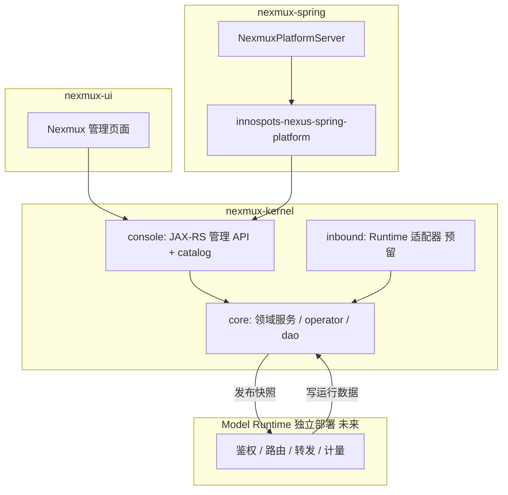

# Nexmux 工程架构设计

## 1. 文档定位

- **状态**：草案（待 grill-me 评审关闭开放问题）
- **日期**：2026-09-26
- **归属模块**：`nexmux-kernel`、`nexmux-spring`、`nexmux-ui`（前端仅引用，本稿不展开 UI 实现）
- **关联文档**：
  - [nexmux-design-catalog.md](../nexmux-design-catalog.md)
  - [ADR-0001 Console/Runtime 边界](./adr/0001-console-runtime-configuration-boundary.md)
  - [nexmux-p0-console-design.md](./nexmux-p0-console-design.md)
  - [nexmux-domain-layer-design.md](./nexmux-domain-layer-design.md)
  - [nexmux-console-entry-plugin-design.md](./nexmux-console-entry-plugin-design.md)
  - [nexmux-ui-spec-pages-design.md](./nexmux-ui-spec-pages-design.md)
  - 产品：[控制台设计 V1.0](../../../product-design/gateweave/模型管理系统-管理控制台产品功能设计文档.md)

## 2. 背景与目标

**Nexmux** 是企业级 **模型资源管理 + 网关 + 运行治理** 平台。本仓库实现 **Model Console**（管理控制面），并预留 **Model Runtime**（数据面）在 `inbound` 包的代码归属。

**成功标准（工程侧）**

1. P0 完成 PRD §25.1「可调用闭环」所需的 Console API、配置持久化、发布与审计（Runtime 联调可滞后但契约先行）。
2. 控制面仅依赖 `innospots-nexus-platform`（内核）+ `innospots-nexus-spring-platform`（组装），不复制 Nexus 模块树。
3. 配置对象平台级统一治理，**不**在 Nexmux 域模型引入 Tenant/Workspace 隔离字段。

## 3. 不在本方案中的能力

| 排除项 | 理由 |
|--------|------|
| 租户/工作空间资源隔离 | PRD §3.7；由上层业务平台负责 |
| 客户账单、应收、结算 | PRD 范围约定 |
| P2 智能路由全套策略 | 仅保留扩展点；实现排期见 §25.3 |
| Nexus 控制台自带用户/角色/菜单插件的二次开发源码复制 | 通过依赖与 catalog 扩展挂接 |
| 在 `nexmux-spring` 内默认启动 Runtime 推理服务 | ADR-0001 |

## 4. 归属与词汇（四步法 ①②）

| 概念 | 英文名 | 归属模块/包 | 技术 ID | 稳定业务键 | 备注 |
|------|--------|------------|---------|-----------|------|
| 供应商 | Provider | `kernel.core.provider` | `provider_id` | `provider_code` | 含 Base URL、协议、凭证引用 |
| 逻辑模型 | Model | `kernel.core.model` | `model_id` | `model_code` | 能力、默认参数、定价引用 |
| 供应商模型绑定 | ModelBindingItem | `kernel.core.model`（列） | — | `(provider_id, provider_model_id)` | 落在 `mux_model` 主绑定列 + `extra_bindings` |
| 路由 | Route | `kernel.core.route` | `route_id` | `alias` | `route_spec` / `published_route_spec`，无版本表 |
| API 客户端 | ApiClient | `kernel.core.access` | `client_id` | `client_code` | AppKey 哈希；`authorized_route_ids` JSON |
| 客户端模板 | ClientTemplate | `kernel.core.access` | `template_id` | `template_code` | 表 `mux_client_template`（P1 启用） |
| 配额/限流 | QuotaPolicy / RateLimitPolicy | `kernel.core.access` | `policy_id` | 挂接 `client_id` | 无独立菜单 |
| 定价 | ModelPricingSpec（列） | `kernel.core.model` | — | — | `mux_model.pricing_spec`；Binding C/M 在同表绑定列 |
| 配置审计 | ConfigAuditLog | `kernel.core.audit` | `audit_id` | — | 与 PRD Audit 对齐 |
| 调用日志（只读） | RequestLog | `kernel.core.ops` | `request_id` | `request_id` | 数据由 Runtime 写入 |
| 控制台 API | — | `kernel.console.endpoint` | — | — | Jersey + `R<T>` |
| 对外推理入口 | Ingress API | `kernel.inbound` | — | — | Runtime 进程；P0 契约预留 |
| 管理 UI | — | `nexmux-ui` | — | — | 对接 Console API + Nexus Shell |

**状态码模块码**：`NMX`（Nexmux 产品域）。

## 5. 边界与包结构（四步法 ③）

### 5.1 逻辑架构



### 5.2 包结构（领域优先，单包 ≤15 类）

```text
com.innospots.nexmux.core
├── provider/          # Provider 聚合（含 domain.entity|request|vo|value）
├── model/             # 逻辑 Model（绑定列在 mux_model）
├── route/             # Route（published_route_spec，无版本表）
├── access/            # Client、ClientTemplate
├── audit/             # ConfigAuditLog
└── ops/               # RequestLog 只读查询

各域内统一：dao / operator / service + domain 子包（详见 nexmux-domain-layer-design.md）

com.innospots.nexmux.console
├── endpoint/          # 按资源分子包，如 provider/、route/
├── catalog/           # 菜单/页面注册（Nexus catalog 贡献）
└── permission/        # nexmux 页面 permission key 常量

com.innospots.nexmux.inbound
├── runtime/           # 配置快照加载、健康缓存接口（实现可后置）
└── protocol/          # OpenAI-compatible 等 Ingress 适配（后置）
```

**依赖规则**

- `console.endpoint` → `core.*` 服务层；**禁止** endpoint 直调 dao。
- `core` **不**依赖 `console`、`inbound`。
- `inbound` 可依赖 `core` 读已发布配置；**禁止** inbound 依赖 `console`。
- 不新增 Maven 模块除非 `java:project` 评审（见 AGENTS.md）。

### 5.3 Session 与持久化作用域

| 场景 | 策略 |
|------|------|
| Nexus 控制台登录会话 | 使用 `SessionContext`（Bearer / PLATFORM realm）仅作**操作者身份**与审计 `created_by` |
| Nexmux 配置实体 | **平台级**；实体基类**不**混入 workspace 隔离字段 |
| 调用链标签 Application / Channel / RouteTag | 仅作路由条件与计量维度，**非**控制台资源隔离键 |

## 6. API 与分层契约（四步法 ④）

### 6.1 管理 API 分组（P0 优先）

管理 REST 统一前缀：`/api/d`（Jersey，与 Nexus Console Web 过滤器配合；**路径不含** `/v1` 等 URL 版本段）。前端 SPA 路由统一前缀：`/page/nexmux/*`（与 `pagePath` / UiSpec `route.path` 一致，**不用** `/console` 段）。

| 资源 | 方法意图 | 路径（示意） | 委托 |
|------|----------|--------------|------|
| Provider | 列表/详情/创建/更新/启停/连接测试 | `/providers` | `ProviderService` |
| Model | 列表/详情/创建/更新/导入/启停/调用测试 | `/models` | `ModelService` |
| Route | 列表/详情/创建/更新/发布/历史 | `/routes` | `RouteService` |
| Client | 列表/详情/创建/更新/启停/AppKey 轮换 | `/clients` | `ClientService` |
| RequestLog | 列表/详情 | `/request-logs` | `RequestLogQueryService` |
| Audit | 列表/详情/Diff | `/audit-logs` | `AuditQueryService` |
| Debug | 模型调试 / 客户端全链路调试 | `/debug/...` | `DebugService` |

响应封装：`com.innospots.nexus.base.domain.response.R<T>`。

### 6.2 分层调用

```text
console.endpoint → core.service → core.operator → core.dao
```

禁止：`operator → endpoint`、跨域 service 循环依赖、未经发布的 Route 被 Runtime 消费。

### 6.3 Request / VO（record 骨架示例）

```java
// 仅契约骨架，非最终实现
public record ProviderCreateRequest(
    String providerCode,
    String displayName,
    String baseUrl,
    String ingressProtocol,
    String upstreamProtocol
) {}

public record RoutePublishRequest(
    String routeId,
    String changeSummary
) {}

public record ClientRotateAppKeyRequest(
    String clientId
) {}
```

集合字段在实现时使用防御性拷贝（规范同 java-reference）。

### 6.4 持久化意图（Console 配置库）

命名前缀：**`mux_`**（产品表统一以 `mux` 为前缀）。一表一 Dao，无 join XML。

| 表 | 主键 | 稳定唯一键 | 说明 |
|----|------|-----------|------|
| `mux_provider` | `provider_id` | `provider_code` | `vendor_code`、`source_vendor_code`、`icon_uri`、连接字段 |
| `mux_provider_credential` | `credential_id` | `provider_id` | 每 Provider 一行活跃凭证 |
| `mux_model` | `model_id` | `model_code` | 绑定列 + `pricing_spec` + `icon_uri` |
| `mux_route` | `route_id` | `alias` | `route_spec` + `published_route_spec` |
| `mux_client` | `client_id` | `client_code` | `authorized_route_ids` |
| `mux_client_template` | `template_id` | `template_code` | P1；无 AppKey |
| `mux_config_audit_log` | `audit_id` | — | 操作 Diff |

运行库表（`mux_request_log` 等）由 Runtime 写入；Console 只读 Dao 可落在 `core.ops`，连接只读数据源或同一库只读账号（部署决策见 P0 实施文档）。

**配置**：分项 YAML 边界见 [nexmux-yaml-configuration-design.md](./nexmux-yaml-configuration-design.md) — `application.yaml` 仅引导；`nexus/console-*.yaml` 为 Nexus 宿主；产品键在 `nexus/nexmux.yaml`（前缀 `nexmux.`）；PageDsl 在 `ui-pages/nexmux/{moduleKey}/*.yaml`（`domainKey=nexmux`，`moduleKey` 为 provider/model 等）。禁止新增业务 `*.properties`。

## 7. 失败与状态码

| 场景 | StatusCode（module+category+local） | 抛出边界 | HTTP 意图 |
|------|-------------------------------------|---------|-----------|
| 资源不存在 | `NMX` + NOT_FOUND + `0001` | Service | 404 |
| 重复业务键 | `NMX` + CONFLICT + `0001` | Service | 409 |
| 启停/发布依赖不满足 | `NMX` + FAILED_PRECONDITION + `0001` | Service（影响分析） | 422 |
| 密钥权限不足 | `NMX` + FORBIDDEN + `0001` | Endpoint 鉴权后 | 403 |
| Route 未发布即被 Runtime 请求 | `NMX` + FAILED_PRECONDITION + `0002` | inbound（后置） | 503 |

实现时先登记 `NexmuxStatusCode` 枚举并实现契约测试；禁止业务失败抛裸 `RuntimeException`。

## 8. 事务、幂等与并发

| 操作 | 事务边界 | 幂等 / 并发 |
|------|----------|-------------|
| Provider/Model/Client 写 | 单聚合单事务 | 以 `*_code` 唯一约束防重复创建 |
| Route 发布 | 单表事务：拷贝 `route_spec` → `published_route_spec` | 审计写 `mux_config_audit_log` |
| AppKey 轮换 | 单 Client 事务 | 旧 key 失效窗口可配置（`nexmux.client.app-key-grace-seconds`） |
| 配置审计 | 与写操作同一事务或可靠异步（P0 同事务） | audit 记录不可变 |

## 9. 兼容与迁移

- 对外 Ingress 协议版本独立演进；管理 API **不在 URL 中带版本号**，兼容性靠增量字段与配置快照内 `schemaVersion`。
- 配置快照 JSON 带 `schemaVersion`；Runtime 拒绝未知主版本。
- 无 legacy 数据迁移（greenfield）。

## 10. 测试范围

| 类型 | 计划类 | 断言要点 |
|------|--------|----------|
| 状态码契约 | `NexmuxStatusCodeContractTest` | 模块码 NMX、无重复 local |
| 实体契约 | `*EntityContractTest` | 表名、唯一索引 |
| Dao 契约 | `*DaoContractTest` | BaseMapper 绑定 |
| 端点契约 | `*EndpointContractTest` | 路径、`R<T>` 包装 |
| 行为单测 | `RoutePublishServiceTest` 等 | 发布、依赖检查、审计 |

集成测试：复用 Nexus sample 模式（Jersey + H2），在 `nexmux-spring` 的 test scope 按需补充（P0 至少覆盖 Provider + Route 发布一条链路）。

不测：P2 智能路由算法、完整 Runtime 压测。

## 11. AGENTS 对齐

| AGENTS 条目 | 本方案符合方式 |
|-------------|----------------|
| 仅四模块 | 不新增 Maven 模块；Runtime 独立 assembly 延后 |
| `nexmux-kernel` → `innospots-nexus-platform` | 领域与 Dao 落在 kernel，不引入 Spring |
| `nexmux-spring` → kernel + spring-platform | 仅 Boot 入口与配置 assembly |
| 禁止模块 POM 内联 version | 依赖版本由 BOM 管理 |
| 包 `core` / `console` / `inbound` | 按 §5.2 划分，不新增并列顶层包 |

**不要求**修订 AGENTS.md，除非立项 `nexmux-runtime` 模块。

## 12. 不建什么（防过度设计）

| 不引入 | 理由 |
|--------|------|
| 独立 `nexmux-api` Maven 模块 | 单产品工程，endpoint 已在 `console` |
| 领域事件总线（配置变更） | P0 用发布表 + 轮询足够；事件在 P1 评估 |
| 通用 `AbstractCrudService` 代码生成 | 每聚合显式服务，避免隐藏规则 |
| Console 内嵌 Runtime 转发 | ADR-0001 |
| 双轨 REST（历史 `/console/*` + 产品 API） | 单轨 `/api/d`（无 URL 版本段） |
| Tenant/Workspace 字段「预留」 | 与 PRD 冲突 |

## 13. 架构约束自检

- [x] 归属模块与 Nexmux 域一致，未与 Nexus 控制台插件源码混仓
- [x] 包结构领域优先
- [x] 术语与 PRD 对象一致（Provider / Model / Route / Client）
- [x] 平台级配置，无 workspace 隔离列
- [x] 分层依赖方向正确
- [x] 失败语义归属 `NexusException` + `NMX` 状态码
- [x] 持久化无 join/XML 规划
- [ ] grill-me 关闭（见 §14）

## 14. 开放问题

| # | 问题 | 建议默认 | 截止 |
|---|------|----------|------|
| 1 | Console API 是否注册为 Nexus `console/datasource` 代理 | 是，与现有 `X-Nexus-Page-Key` 权限模型一致 | P0 启动前 |
| 2 | 运行数据与配置是否同库 | 开发 H2 可同库不同 schema；生产分离 | 部署设计前 |
| 3 | Runtime 首版是否独立仓库 | 建议仍属 innospots-gen 新 module，非本仓库 | Runtime 立项时 |

## 15. 分阶段路线图（与 PRD §25 对齐）

| 阶段 | 工程交付物 |
|------|------------|
| **P0** | [nexmux-p0-console-design.md](./nexmux-p0-console-design.md) 全部管理 API + 发布 + 审计 + 日志只读 + 调试台 API；`nexmux-ui` P0 页面 |
| **P1** | Dashboard、Template、多维用量、成本明细、条件路由/灰度/Failover 等；可能引入只读 OLAP 或导出任务 |
| **P2** | 智能路由策略包；`inbound` 内策略扩展点 |

UI 线框与页面清单位图见 [产品线框图目录](../../../product-design/gateweave/prd-diagram/README.md)。
